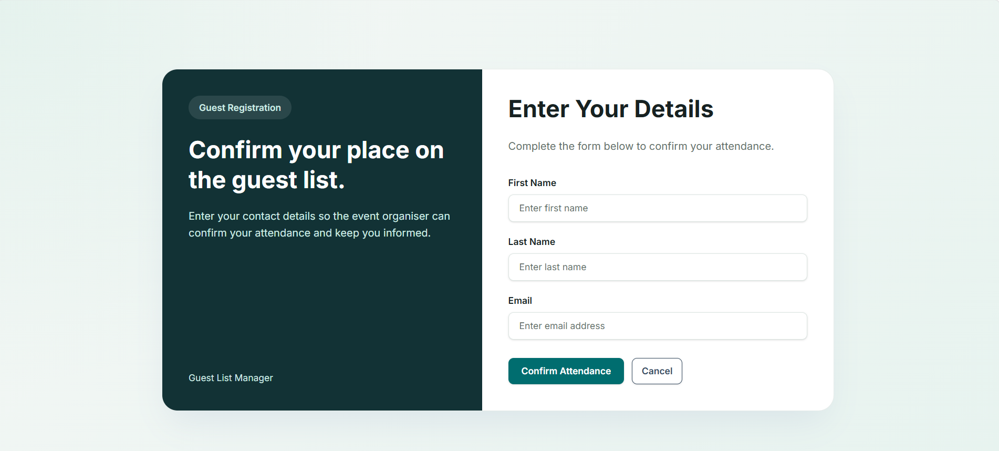
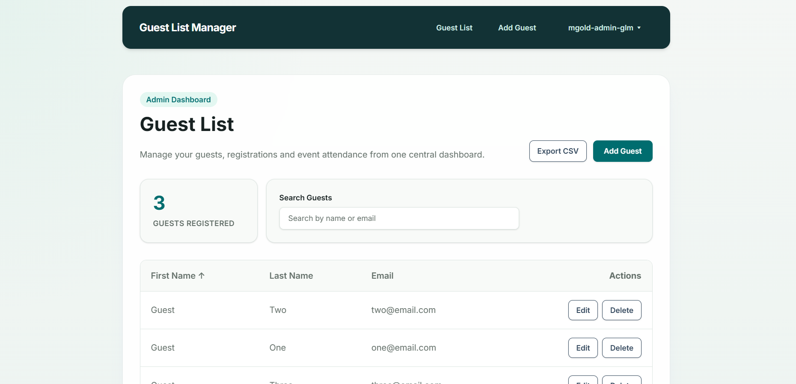
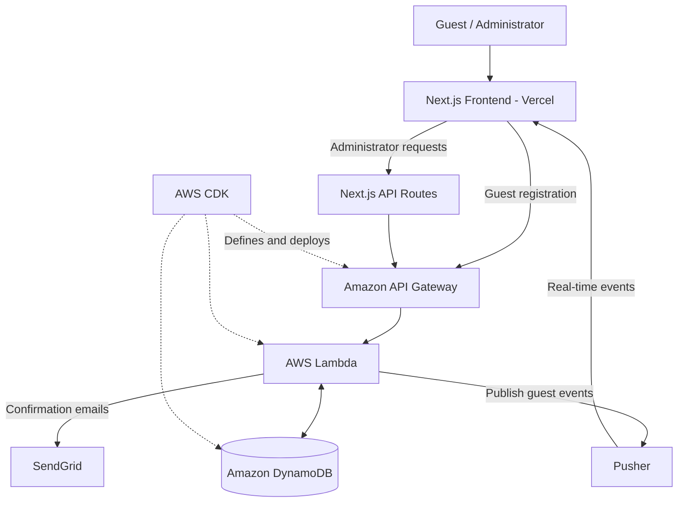

# Guest List Manager

This is a full-stack web application for managing guest lists and associated guest registrations. It acts as a centralised system for guest sign-up and subsequent management of the guest list. It is designed so that it can easily be rebranded to suit different events and organisations.

The application has separate interfaces for guest registration and admin-only guest list management. Guests can sign up for an event, provided there is capacity, and receive a confirmation email upon registration. The password-protected admin system allows administrators to manage registrations, search through the guest list and export it as a CSV file.


## Live Application and Links
- **Live Application:** [View the deployed application](https://guest-list-project.vercel.app/)
- **GitHub Repository:** [View the source code](https://github.com/MGold101/guest-list-project)
- **Frontend Documentation:** [Frontend README](frontend/README.md)
- **Backend and Infrastructure Documentation:** [Infrastructure README](infrastructure/README.md)


## Application Screenshots

### Guest Registration



### Administrator Guest List



## Project Overview and Motivation
Managing guest registrations for events can involve keeping track of attendance, available capacity and guest information. Doing this manually can become complicated as the number of guests increases, potentially leading to errors such as guests being missed or exceeding event capacity. This application aims to bring guest registration and guest list management into a single centralised system.

This system was originally developed as part of my summer internship at IMA, where I was tasked with creating a guest list management system using AWS and Next.js, inspired by the needs of a real client. However, the system was designed without specific branding so that it could be adapted for multiple organisations. The aim was to create a simple and accurate process that was easy for guests to follow and allowed administrators to securely manage registrations. My personal goal was to gain experience creating cloud-based infrastructure while applying the frontend development and design skills I had learnt earlier in my internship.

The main objectives were to create a secure admin dashboard accessible only to authenticated administrators, develop a guest registration process that incorporated email confirmations while respecting event capacity, and implement real-time updates within the admin dashboard so administrators could keep track of registrations as they occurred.


## Key Features

### Guest Registration

- **Guest Registration Form:** Guests can register for an event through a dedicated sign-up interface, allowing registrations to be collected and managed within a centralised system.

- **Registration Validation:** All fields in the registration form are required, and the system checks whether an email address has already been registered to prevent duplicate sign-ups.

- **Capacity Restrictions:** The system restricts guest registrations based on a configurable maximum capacity, helping to prevent events from exceeding their intended number of guests. Once capacity is reached, access to the registration form is restricted. If capacity is reached while a guest is completing their registration, the system displays a rejection message.

- **Email Confirmations:** Guests receive a confirmation email following successful registration, providing confirmation that their details have been recorded.

- **Form Validation:** Uses Zod schemas to validate guest registration details and provide feedback when submitted information is invalid.

### Administrator Management

- **Administrator Authentication:** The administrator interface is login and password-protected, restricting access to guest list management functionality to authenticated administrators.

- **Guest List Management:** Administrators can view the guest list and manually add, edit or delete guest records. This allows registrations to be managed and updated when required.

- **Search and Sorting:** Administrators can search through the guest list using a guest's first name, last name or email address. The guest list can also be sorted alphabetically by these same fields, making it easier to locate specific registrations and organise guest information.

- **CSV Export:** The guest list can be exported as a CSV file, allowing administrators to access and use registration information outside the application.

- **Real-Time Updates:** Changes to the guest list, including additions, edits and deletions, are reflected in real time across administrator sessions. This allows multiple administrators to manage the guest list simultaneously without having to manually refresh the page.

- **Registration Notifications:** Administrators receive toast notifications when guests register through the guest-facing interface, helping them keep track of new registrations as they occur.


## Technology Stack

### Frontend

- **JavaScript:** Used to develop the frontend functionality and interactive components.
- **Next.js:** Used to develop the frontend of the application, including the guest registration and administrator interfaces.
- **React:** Used to create reusable interface components and manage interactive functionality.
- **Tailwind CSS:** Used to style the application and its interfaces.
- **Zod:** Used to define validation schemas for the guest registration form, ensuring that submitted information meets the required format.

### Backend

- **Node.js:** Provides the JavaScript runtime environment for the backend.
- **AWS Lambda:** Runs the backend functionality for processing guest registrations and administrator operations.
- **Amazon API Gateway:** Provides the API used for communication between the frontend and backend.

### Cloud Infrastructure and Database

- **Amazon DynamoDB:** Stores guest registration data.
- **AWS Cloud Development Kit (CDK):** Used to define and deploy the AWS infrastructure as code.

### External Services and Deployment

- **Pusher:** Used to provide real-time guest list updates and registration notifications.
- **SendGrid:** Used to send confirmation emails to guests following successful registration.
- **Vercel:** Used to host and deploy the Next.js frontend.


## System Architecture

The application uses a Next.js frontend hosted on Vercel, with a serverless backend built using AWS services. Guest registration requests are sent to Amazon API Gateway, which connects to AWS Lambda for processing. Guest information is stored in an Amazon DynamoDB database.

Administrator requests are handled through Next.js API routes, which forward login and guest management requests to the AWS backend. Following a successful login, an authentication token is stored in an HTTP-only cookie and used for subsequent administrator requests. The backend verifies the token before allowing access to protected guest management functionality.

The application also integrates SendGrid for guest registration confirmation emails and Pusher for real-time updates. The backend publishes guest list changes through Pusher, while connected administrator interfaces subscribe to these events. This allows multiple administrators to see changes without manually refreshing the page, with additional toast notifications for new guest sign-ups.

The AWS infrastructure is defined and deployed using AWS CDK, allowing cloud resources to be managed through code.

### Architecture Diagram




## Technical Implementation and Design Decisions

### Frontend Component Structure

The frontend was developed using Next.js and React, following an Atomic Design approach to organise components into atoms, molecules and organisms. This allowed smaller, reusable components to be combined into larger sections of the interface, making the application easier to develop and maintain.

The guest registration and administrator interfaces are separated, with additional functionality organised into services, hooks and contexts. This helps keep the application structured and separates interface components from other application logic.

### Form Validation

Zod is used to define validation schemas for the guest registration form, helping ensure that submitted information meets the required format before it is sent to the backend. This provides structured validation rules and allows the interface to give users feedback when their input is invalid.

Validation is also handled by the backend for rules such as duplicate registrations and guest capacity, so the application does not rely solely on frontend checks.

### Administrator Authentication

I independently implemented the application's JWT-based administrator authentication system, using research and technical documentation to guide my approach. This included credential verification, token generation, HTTP-only cookie handling and backend verification of protected requests. When an administrator logs in, their credentials are sent through a Next.js API route to the AWS backend, where they are validated. Following a successful login, the backend generates a JSON Web Token (JWT), which is stored in an HTTP-only cookie by the Next.js application.

Subsequent administrator requests use this token to authenticate with the backend. Protected Lambda routes verify the JWT before allowing guest management operations, ensuring that access restrictions are enforced by the backend as well as the frontend.

### Capacity Management

The maximum number of guests is controlled through a configurable `MAX_GUESTS` value in `infrastructure/lambda/config/guestConfig.js`. This allows the event capacity to be changed without having to modify the registration interface, making the application easier to adapt for different events.

When the maximum capacity is reached, the registration form becomes unavailable to new guests. The backend also checks the capacity when processing registrations, meaning that if the event becomes full while someone is completing the form, their registration is rejected and an appropriate message is displayed.

### Real-Time Updates

Pusher is used to provide real-time updates to the administrator guest list. When guest records are added, edited or deleted, the backend publishes events that are received by connected administrator interfaces.

The frontend subscribes to the `guest-added`, `guest-updated` and `guest-deleted` events, allowing multiple administrators to see changes without manually refreshing the page. Toast notifications are also displayed when a new guest registers through the guest-facing interface, helping administrators keep track of incoming registrations.

### Data Management and External Services

Amazon DynamoDB is used to store guest registration records, with AWS Lambda handling the backend operations required to create, retrieve, update and delete guest information.

The administrator interface also includes CSV export functionality, allowing the guest list to be downloaded and used outside the application.

SendGrid is integrated into the registration process to send confirmation emails following successful guest sign-ups. This provides guests with confirmation that their registration has been recorded.


## Project Structure

The repository is divided into separate frontend and infrastructure directories, allowing the user interfaces and backend functionality to be developed and maintained independently.

```text
guest-list-project/
├── frontend/
│   ├── README.md
│   └── src/
│       ├── app/
│       ├── components/
│       │   ├── atoms/
│       │   ├── molecules/
│       │   └── organisms/
│       ├── context/
│       ├── hooks/
│       ├── services/
│       └── utils/
├── infrastructure/
│   ├── README.md
│   ├── bin/
│   ├── lib/
│   ├── lambda/
│   └── test/
├── screenshots/
└── README.md
```

### Frontend

The `frontend` directory contains the Next.js application, including the guest registration and administrator interfaces. Components are organised using Atomic Design, while services, hooks and contexts help separate application functionality from the interface components.

For more information, see the [Frontend README](frontend/README.md).

### Backend and Infrastructure

The `infrastructure` directory contains the AWS CDK configuration and Lambda backend. The CDK stack defines the AWS resources used by the application, while the Lambda code handles guest registration, authentication and guest list management.

For more information, see the [Infrastructure README](infrastructure/README.md).


## Getting Started

The application is divided into separate frontend and infrastructure projects. The frontend can be run locally using Next.js, while the backend requires AWS infrastructure and configuration for the external services used by the application.

### Prerequisites

Before setting up the project, the following are required:

- **Node.js and npm** for installing dependencies and running the application.
- **An AWS account and configured AWS credentials** for deploying the backend infrastructure.
- **Pusher credentials** for real-time guest list updates.
- **SendGrid credentials** for registration confirmation emails.

### Local Frontend Setup

Clone the repository and navigate to the frontend directory:

```bash
git clone https://github.com/MGold101/guest-list-project.git
cd guest-list-project/frontend
```

Install the frontend dependencies:

```bash
npm install
```

Create a `.env.local` file using `frontend/.env.example` as a reference and provide the required environment variables:

```dotenv
NEXT_PUBLIC_API_URL=
NEXT_PUBLIC_PUSHER_KEY=
NEXT_PUBLIC_PUSHER_CLUSTER=
```

Once the environment variables have been configured, start the development server:

```bash
npm run dev
```

The frontend can then be accessed at [http://localhost:3000](http://localhost:3000).

The frontend requires a configured backend API for guest registration and administrator functionality to work correctly.

### Backend and Infrastructure Setup

The backend is implemented using AWS Lambda, Amazon API Gateway and Amazon DynamoDB, with the infrastructure defined using AWS CDK.

The infrastructure project has its own dependencies and environment configuration. Its deployment scripts also reference a specific AWS CLI profile, so these must be reviewed and configured for the AWS account being used.

For more detailed backend configuration and deployment instructions, see the [Infrastructure README](infrastructure/README.md).

### Environment Configuration

Both the frontend and infrastructure directories contain `.env.example` files documenting the required environment variables.

These example files should be used as references when creating local environment configuration files. Actual passwords, authentication secrets and API keys should not be committed to the repository.


## Testing and Validation

The Guest List Manager was tested manually throughout development to check that the guest registration process, administrator functionality and integrations worked as expected. Testing involved interacting with the application through the guest and administrator interfaces and checking how it responded to different inputs and actions.

### Guest Registration

Manual testing focused on the guest registration process, including:

- Submitting the registration form with valid guest details.
- Checking that required fields and Zod validation rules provided feedback for invalid inputs.
- Attempting to register an email address that was already in use.
- Checking that successful registrations appeared in the guest list.
- Checking that registration confirmation emails were sent through SendGrid.
- Checking that registration was restricted when the configured guest capacity was reached.

### Administrator Functionality

The administrator interface was manually checked to verify:

- Logging in using valid administrator credentials.
- Restricting access to administrator functionality without authentication.
- Adding, editing and deleting guest records.
- Searching for guests by first name, last name and email address.
- Sorting guest records alphabetically.
- Exporting the guest list as a CSV file.

### Real-Time Updates

Pusher functionality was checked by observing whether changes to guest records appeared in connected administrator interfaces without requiring a page refresh.

This included guest additions, updates and deletions, as well as toast notifications when a new guest registered through the public form.

### Testing Approach

Testing was carried out manually rather than through an automated test suite. This allowed the main user journeys and integrations to be checked during development, although automated unit and integration testing would be a useful future improvement.


## Challenges, Learning and Future Improvements

Developing the Guest List Manager during my internship at IMA gave me the opportunity to apply my existing frontend development skills while gaining experience with backend development, cloud infrastructure and third-party services.

### Technical Challenges

One of the main challenges was implementing administrator authentication. I researched how JWT-based authentication works and independently implemented the authentication flow, including handling login requests, generating tokens and verifying authentication on the backend. This helped me develop a better understanding of authentication across a full-stack application.

Another challenge was managing the interaction between the frontend and AWS backend. The application uses API Gateway, Lambda and DynamoDB, so I needed to understand how requests move between these services and how to handle responses and errors appropriately.

Implementing real-time guest list updates was also an important part of the project. Using Pusher allowed changes to guest records to appear in connected administrator interfaces without requiring a page refresh, helping me understand how event-driven functionality can improve the user experience.

### Skills and Learning

Through this project, I developed my knowledge of full-stack application development and gained practical experience with AWS services and infrastructure as code using AWS CDK.

I also strengthened my understanding of reusable React components, frontend validation using Zod, API communication and integrating external services such as SendGrid and Pusher.

Working on an application inspired by a real client's requirements helped me consider how technical decisions affect usability, maintainability and the potential for an application to be adapted for different organisations and events.

### Future Improvements

Although the application provides the main functionality needed for guest registration and management, there are several features I would like to explore in future development:

- **Mass Emailing:** Allow administrators to send an email to all registered guests, making it easier to communicate event information and updates.
- **Email Invitations:** Allow administrators to send invitations containing a link to the guest registration form.
- **QR Code Check-In:** Generate QR codes for registered guests that could be scanned when they arrive at an event, helping administrators track attendance.
- **Automated Testing:** Introduce unit and integration tests to improve confidence in the application's functionality and reduce reliance on manual testing.

These improvements would extend the application beyond guest registration and management towards a more complete event administration system.


## Author and Professional Development

I developed the Guest List Manager during my summer internship at IMA as an opportunity to apply my existing frontend development knowledge while expanding my skills in full-stack development and cloud technologies.

I was responsible for developing the application's frontend interfaces, implementing backend functionality and working with AWS services to support guest registration and administrator management. This included independently implementing the JWT-based administrator authentication system, integrating external services and organising the frontend using reusable components.

Working on a project inspired by a real client's requirements gave me experience of considering both technical functionality and the needs of the people using the application. It also helped me develop my problem-solving skills and confidence in working across different parts of a full-stack application.

This project represents an important part of my professional development and demonstrates my growing ability to design, develop and document a full-stack web application.

### Connect With Me

- **GitHub:** [MGold101](https://github.com/MGold101)
- **LinkedIn:** [Marcello Gold](https://www.linkedin.com/in/marcellogold/)
